# Car Show Registration System (Car Show 2027) — Verification & Documentation

This directory contains the complete verification evidence, endpoint test results, database schema inspections, and application integration screenshots required for the **Integrative Programming 2** test project.

---

## Team & Roles

| Member | Role | Responsibilities |
| :--- | :--- | :--- |
| **Whindell B. Doroja** | Backend Developer | .NET 10 Minimal APIs, Vertical Slice Architecture, EF Core SQLite persistence, FluentValidation, Scalar OpenAPI, test scenarios |
| **Andrew E. DeVera** | Frontend Developer | React 19, Vite, Tailwind CSS, KPI dashboard cards, registration table, filters, pagination |

---

## Table of Contents

- [Part 1: Backend Verification Screenshots (Whindell Doroja)](#part-1-backend-verification-screenshots-whindell-doroja)
  1. [Screenshot 1 — Solution & Folder Structure (Vertical Slices)](#screenshot-1--solution--folder-structure)
  2. [Screenshot 2 — Scalar OpenAPI Interactive Documentation](#screenshot-2--scalar-openapi-interactive-documentation)
  3. [Screenshot 3 — SQLite Database (`carshow.db`) & EF Core Migrations](#screenshot-3--sqlite-database-carshowdb--ef-core-migrations)
  4. [Screenshot 4 — POST: Successful Registration (201 Created)](#screenshot-4--post-successful-registration-201-created)
  5. [Screenshot 5 — POST: Validation Errors (400 Bad Request)](#screenshot-5--post-validation-errors-400-bad-request)
  6. [Screenshot 6 — POST: Duplicate Plate Number (409 Conflict)](#screenshot-6--post-duplicate-plate-number-409-conflict)
  7. [Screenshot 7 — GET All: Paginated Registrations List](#screenshot-7--get-all-paginated-registrations-list)
  8. [Screenshot 8 — GET Filtered Registrations](#screenshot-8--get-filtered-registrations)
     - [8a. Filter by Registration Type (`?type=Competitor` / `?type=VIP`)](#8a-filter-by-registration-type)
     - [8b. Filter by Registration Status (`?status=Pending`)](#8b-filter-by-registration-status)
     - [8c. Filter by Participant Name (`?participantName=juan`)](#8c-filter-by-participant-name)
  9. [Screenshot 9 — GET by ID (Found & Not Found)](#screenshot-9--get-by-id-found--not-found)
     - [9a. GET by ID — Found (200 OK)](#9a-get-by-id--found-200-ok)
     - [9b. GET by ID — Not Found (404 Not Found)](#9b-get-by-id--not-found-404-not-found)
  10. [Screenshot 10 — GET Registration Summary (KPI Totals)](#screenshot-10--get-registration-summary-kpi-totals)
  11. [Screenshot 11 — Test Scenarios & `Api.http` Suite](#screenshot-11--test-scenarios--apihttp-suite)
  12. [Screenshot 12 — GitHub Commit History](#screenshot-12--github-commit-history)
  13. [Screenshot 13 — Running Full Application (React Dashboard Integration)](#screenshot-13--running-full-application-react-dashboard-integration)
- [Part 2: Frontend Verification Screenshots (Andrew DeVera)](#part-2-frontend-verification-screenshots-andrew-devera)
  1. [Screenshot 1 — `frontend/src` Folder Structure](#screenshot-1--frontendsrc-folder-structure)
  2. [Screenshot 2 — Full Dashboard: KPI Cards + Table + Pagination](#screenshot-2--full-dashboard-kpi-cards--table--pagination)
  3. [Screenshot 3 — Loading State (Skeleton Rows)](#screenshot-3--loading-state-skeleton-rows)
  4. [Screenshot 4 — Search by Participant Name](#screenshot-4--search-by-participant-name)
  5. [Screenshot 5 — Filter by Registration Type & Status](#screenshot-5--filter-by-registration-type--status)
     - [5a. Filter by Registration Type (`?type=Competitor`)](#5a-filter-by-registration-type)
     - [5b. Filter by Registration Status (`?status=Pending`)](#5b-filter-by-registration-status)
  6. [Screenshot 6 — Paging — Page 2 with "Showing x–y of N" Summary](#screenshot-6--paging--page-2-with-showing-xy-of-n-summary)
  7. [Screenshot 7 — Empty State (Filters with No Results)](#screenshot-7--empty-state-filters-with-no-results)
  8. [Screenshot 8 — Error State (API Stopped)](#screenshot-8--error-state-api-stopped)
  9. [Screenshot 9 — Browser DevTools Network Tab & JSON Response](#screenshot-9--browser-devtools-network-tab--json-response)
     - [9a. GET Request Headers & Query Parameters](#9a-get-request-headers--query-parameters)
     - [9b. JSON Response Payload](#9b-json-response-payload)
  10. [Screenshot 10 — GitHub Commit History](#screenshot-10--github-commit-history)
     - [10a. Commit History (Page 1)](#10a-commit-history-page-1)
     - [10b. Commit History (Page 2)](#10b-commit-history-page-2)
     - [10c. Commit History (Page 3)](#10c-commit-history-page-3)
     - [10d. Commit History (Page 4)](#10d-commit-history-page-4)
  11. [Screenshot 11 — Running Full Application (API & React App Integration)](#screenshot-11--running-full-application-api--react-app-integration)

---

# Part 1: Backend Verification Screenshots (Whindell B. Doroja)

### Screenshot 1 — Solution & Folder Structure

Shows the Clean Architecture + Vertical Slice Architecture layout in .NET 10. Each feature is encapsulated in `Application/Features/Registrations/` containing its command/query, handler, and validator together. Zero cross-slice pollution.

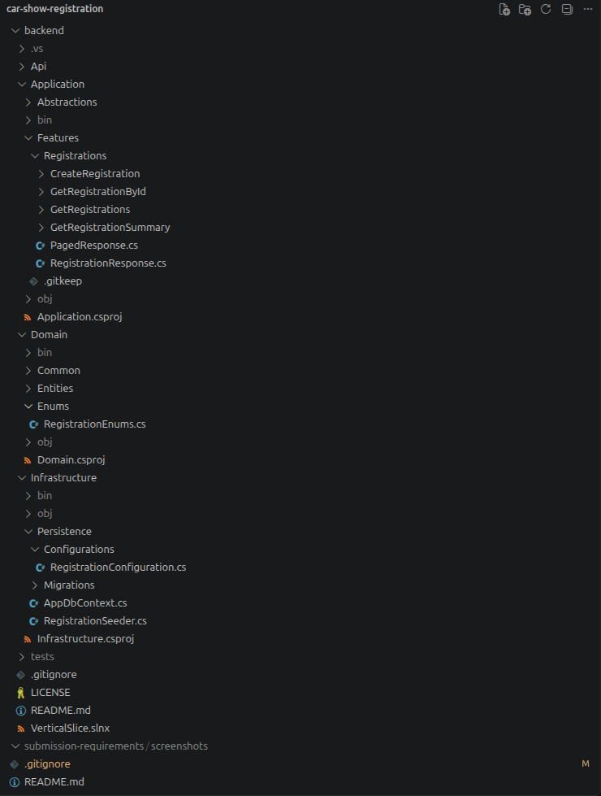

---

### Screenshot 2 — Scalar OpenAPI Interactive Documentation

Shows the Scalar API Reference UI running at `http://localhost:5205/scalar/v1`, listing all registration endpoints under the `/api/registrations` route group.

---

### Screenshot 3 — SQLite Database (`carshow.db`) & EF Core Migrations

Shows the `carshow.db` database opened in DB Browser for SQLite with the 25 seeded records, unique database indexes on `PlateNumber` and `RegistrationNumber`, and the `Infrastructure/Persistence/Migrations/` folder.

---

### Screenshot 4 — POST: Successful Registration (201 Created)

Shows a successful registration creation returning `201 Created`. Demonstrates server-side generation of sequential number (`CS27-xxxx`), UTC `RegistrationDate`, fee determination based on type (Exhibitor: ₱1,500, Competitor: ₱2,500, VIP: ₱5,000), dynamic `PaymentStatus` calculation, and `Location` header pointing to the new resource.

---

### Screenshot 5 — POST: Validation Errors (400 Bad Request)

Shows validation handling through `ValidationFilter<T>` using FluentValidation. When required fields are missing or invalid (e.g. invalid contact number format, invalid email, empty fields), the endpoint short-circuits and returns `400 Bad Request` with structured `ProblemDetails` containing field-level errors.

---

### Screenshot 6 — POST: Duplicate Plate Number (409 Conflict)

Shows duplicate plate number prevention (one car = one registration). Attempting to register an existing vehicle plate returns a `409 Conflict` status code with ProblemDetails specifying `Registration.Conflict`.

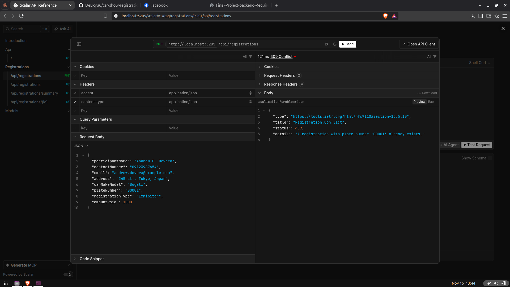

---

### Screenshot 7 — GET All: Paginated Registrations List

Shows `GET /api/registrations?page=1&pageSize=10` returning a paginated list of registrations ordered by `RegistrationDate` descending (newest first), with total count, current page, page size, and total pages metadata.

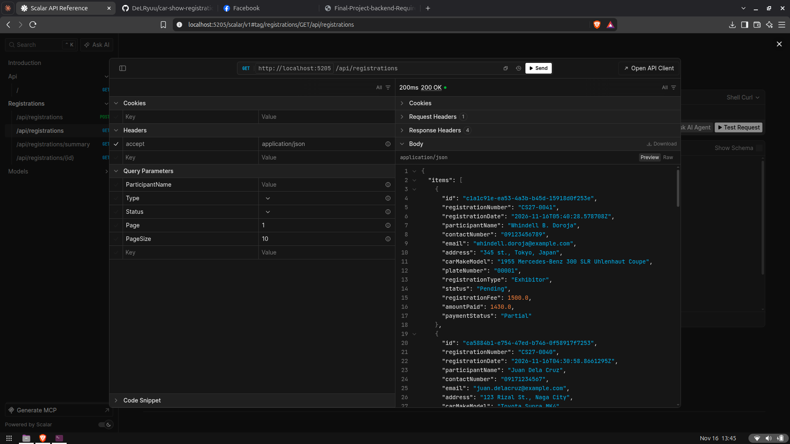

---

### Screenshot 8 — GET Filtered Registrations

Demonstrates server-side query filtering across types, statuses, and participant names.

#### 8a. Filter by Registration Type
Query: `GET /api/registrations?type=Competitor` (or `?type=VIP`)

#### 8b. Filter by Registration Status
Query: `GET /api/registrations?status=Pending`

#### 8c. Filter by Participant Name
Query: `GET /api/registrations?participantName=juan` (case-insensitive substring match)

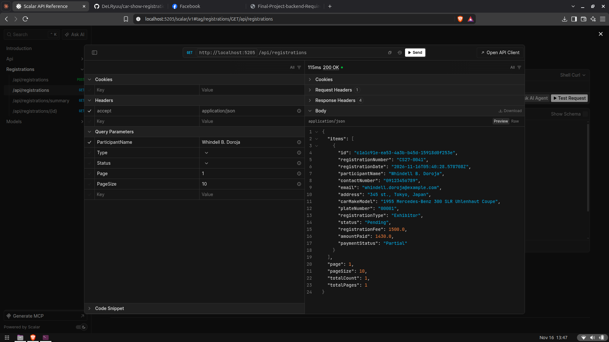

---

### Screenshot 9 — GET by ID (Found & Not Found)

Demonstrates fetching single registration details by GUID identifier with route constraint (`{id:guid}`).

#### 9a. GET by ID — Found (200 OK)
Returns `200 OK` with full registration record.

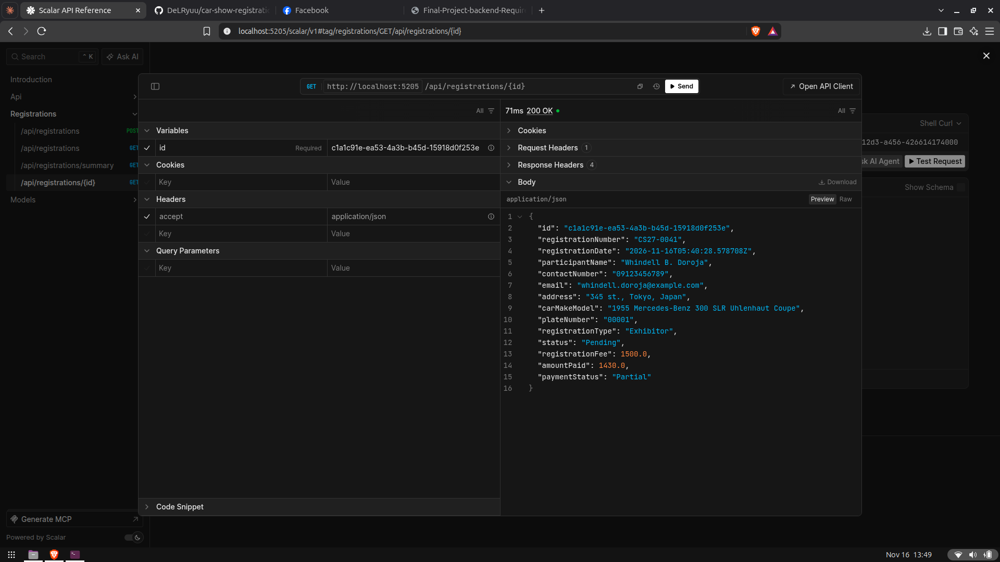

#### 9b. GET by ID — Not Found (404 Not Found)
Returns `404 Not Found` with ProblemDetails (`Registration.NotFound`) when a non-existent GUID is queried.

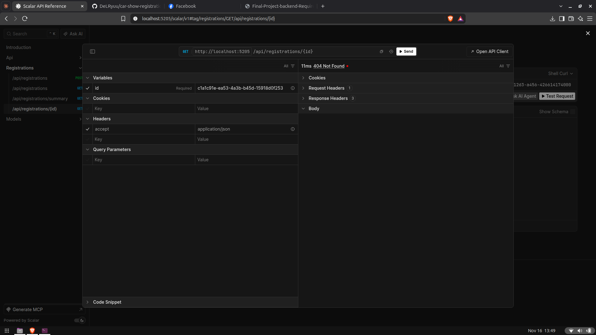

---

### Screenshot 10 — GET Registration Summary (KPI Totals)

Shows `GET /api/registrations/summary` returning aggregated metrics for the frontend KPI dashboard cards: `totalRegistrations`, counts per status (`confirmed`, `checkedIn`, `pending`, `cancelled`), and financial sums (`totalFees`, `totalPayments`, `uncollectedPayments`). Cancelled registrations are strictly excluded from revenue calculations.

---

### Screenshot 11 — Test Scenarios & `Api.http` Suite

Shows execution and verification of the 40 test scenarios defined in `Api.http` matching Section 3G of the project specification (POST creation rules, validation constraints, pagination, filtering, summary accuracy, and error handling).

---

### Screenshot 12 — GitHub Commit History

Shows the granular, atomic Git commit history created by the Backend Developer throughout development, adhering to the project requirements for clear, meaningful commit messages.

---

### Screenshot 13 — Running Full Application (React Dashboard Integration)

Shows the full integrated stack in action: the React 19 + Tailwind CSS frontend dashboard running on `http://localhost:5173` successfully communicating with the C# / .NET 10 API backend on `http://localhost:5205`. Live KPI totals, filtering, and table rendering are fully operational.

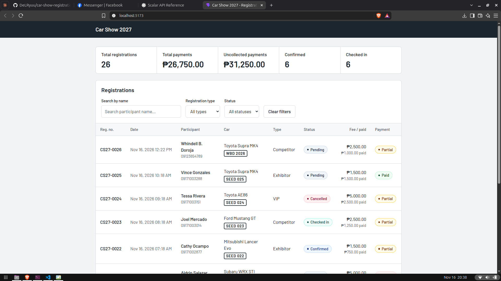

---

# Part 2: Frontend Verification Screenshots (Andrew E. DeVera)

### Screenshot 1 — `frontend/src` Folder Structure

Shows the modular directory layout of the React (Vite) application inside `frontend/src/`. Reusable UI components (`KpiCards`, `RegistrationTable`, `RegistrationFilters`, `Pagination`, `TableSkeleton`, `StatusBadge`, `PaymentBadge`) are separated from API service modules (`registrationsApi.ts`, `sampleData.ts`), custom hooks (`useDebounce.ts`), TypeScript contracts (`types/registration.ts`), and formatters (`utils/format.ts`).

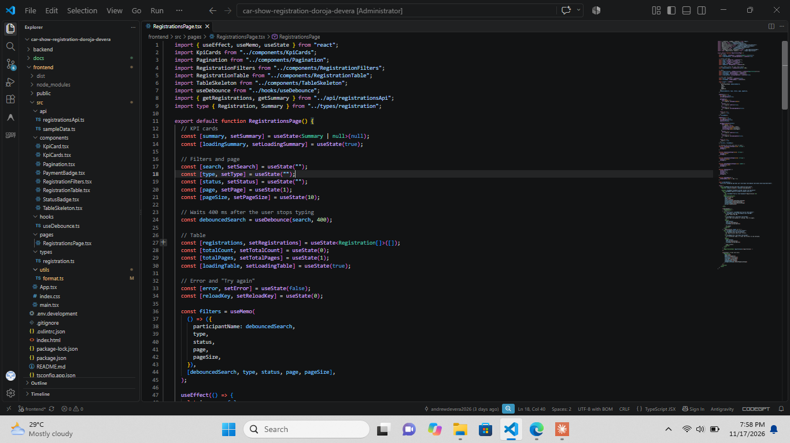

---

### Screenshot 2 — Full Dashboard: KPI Cards + Table + Pagination

Shows the full Car Show 2027 Registration Dashboard running against the live .NET 10 API backend on `http://localhost:5205`. At the top, the KPI card strip displays the 5 aggregate metrics (`Total Registrations: 25`, `Total Payments: ₱42,000.00`, `Uncollected Payments: ₱19,500.00`, `Confirmed: 10`, `Checked In: 6`) fetched directly from `GET /api/registrations/summary`. The table renders the first 10 vehicle registrations with formatted dates, participant contacts, custom license plate badges, status pills, and right-aligned Philippine Peso amounts.

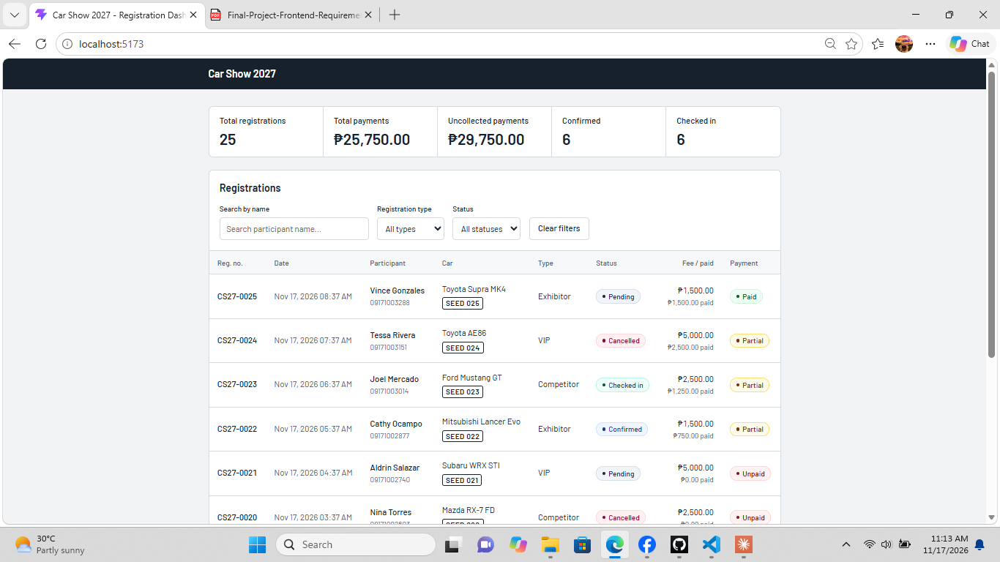

---

### Screenshot 3 — Loading State (Skeleton Rows)

Shows the dashboard loading state while asynchronous data is being fetched from the backend. Instead of displaying a blank screen or a basic spinner, the dashboard renders the bonus `TableSkeleton` component with grey animated shimmer placeholder rows. Each row replicates the height, column proportions, and badge positions of the real table, eliminating Cumulative Layout Shift (CLS).

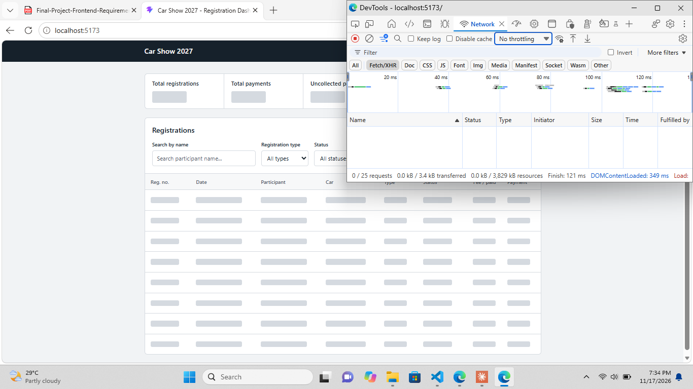

---

### Screenshot 4 — Search by Participant Name

Shows dynamic participant name filtering in action. As the user types into the search box, the custom `useDebounce` hook waits 400ms after the last keystroke before issuing a query to `GET /api/registrations?participantName=...&page=1&pageSize=10`. The C# backend performs a case-insensitive substring match and returns only matching participants. The table updates instantly with the filtered rows, and the active page automatically resets to page 1.

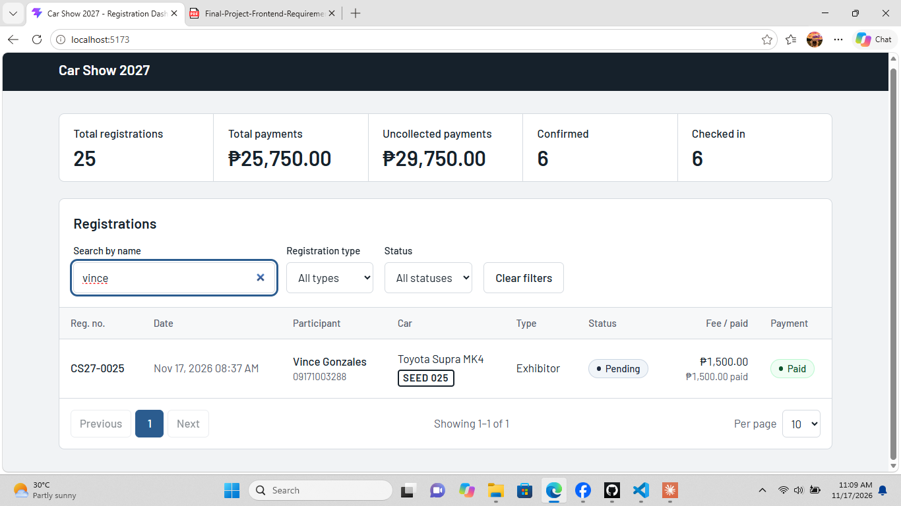

---

### Screenshot 5 — Filter by Registration Type & Status

Demonstrates server-side query filtering using the dropdown controls for registration type and status.

#### 5a. Filter by Registration Type
Query: `GET /api/registrations?type=Competitor` (or `?type=VIP`)

Selecting a registration type from the dropdown immediately dispatches a filtered API query. The result displays only participants matching the selected category (e.g. Competitor entries with their ₱2,500.00 registration fee). The pagination counter updates dynamically to reflect the count of records within the filtered subset.

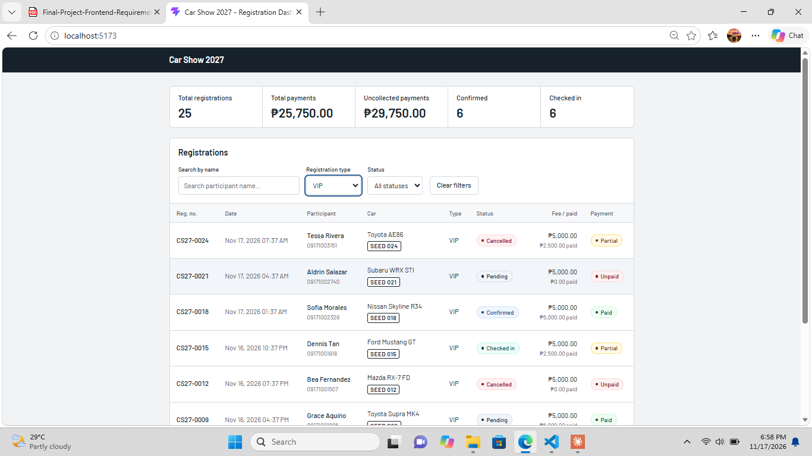

#### 5b. Filter by Registration Status
Query: `GET /api/registrations?status=Pending` (or `?status=Confirmed`)

Filtering by workflow status allows event coordinators to quickly isolate entries requiring staff action. Selecting `Pending` sends `GET /api/registrations?status=Pending`, updating the table to display only unconfirmed submissions with distinct yellow status badges. Modifying the filter automatically resets the active page index to 1.

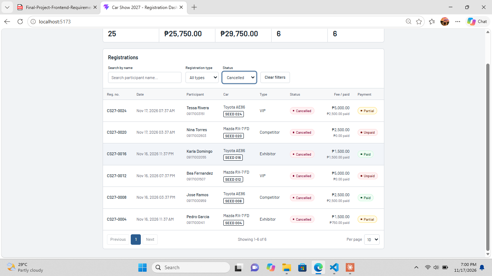

---

### Screenshot 6 — Paging — Page 2 with "Showing x–y of N" Summary

Shows the pagination controls after advancing to page 2 of the registrations list. The active page button (`2`) is highlighted with the primary steel blue theme (`bg-steel text-white`), and the summary text updates to "Showing 11–20 of 25". Both Previous and Next navigation buttons remain active, while navigation is disabled when the first or last page is reached. The page-size selector allows staff to customize table density between 5, 10, or 20 rows per page.

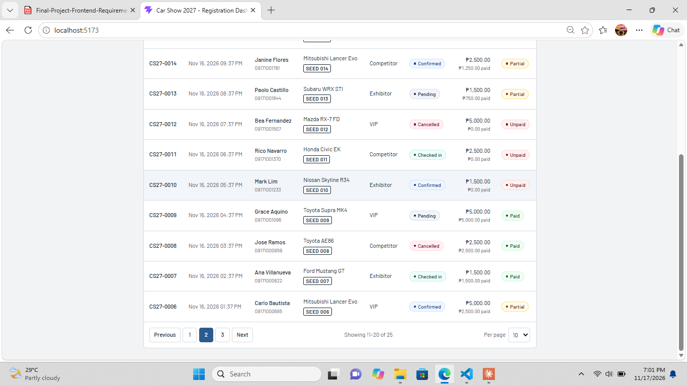

---

### Screenshot 7 — Empty State (Filters with No Results)

Shows the intuitive empty state rendered when a search term or filter combination yields zero matching registrations (`registrations.length === 0`). Instead of an empty, ambiguous table, the dashboard presents a user-friendly message: "No registrations match your filters. Try a different name, or clear the filters to see everyone." A prominent "Clear filters" button triggers `handleClear()` to reset all search inputs, dropdowns, and pagination back to initial state.

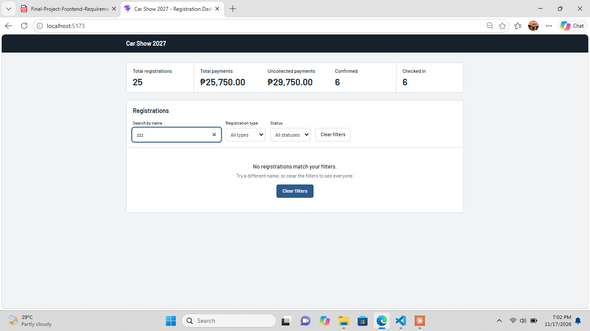

---

### Screenshot 8 — Error State (API Stopped)

Shows graceful error handling when the C# backend API is stopped or cannot be reached. When fetch requests in `src/api/registrationsApi.ts` fail to connect, `RegistrationsPage` catches the exception and sets `error` to true. The view displays a clear alert stating "Cannot reach the API. Check that the backend is running, then try again." alongside a "Try again" retry button.

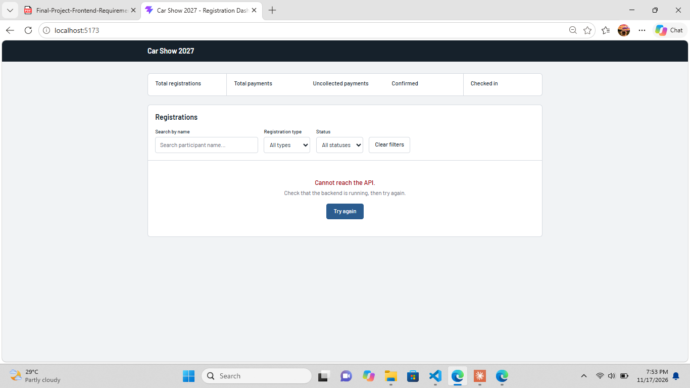

---

### Screenshot 9 — Browser DevTools Network Tab & JSON Response

Demonstrates verification of the browser network traffic and JSON contract compliance between the React dashboard and the .NET 10 API.

#### 9a. GET Request Headers & Query Parameters
Request: `GET http://localhost:5205/api/registrations?participantName=&type=&status=&page=1&pageSize=10`

Shows the Chrome DevTools Network panel capturing a successful HTTP request returning status `200 OK`. The query string parameters align exactly with the agreed API contract. The response headers verify that Cross-Origin Resource Sharing (CORS) is properly configured on the backend, allowing origin `http://localhost:5173`.

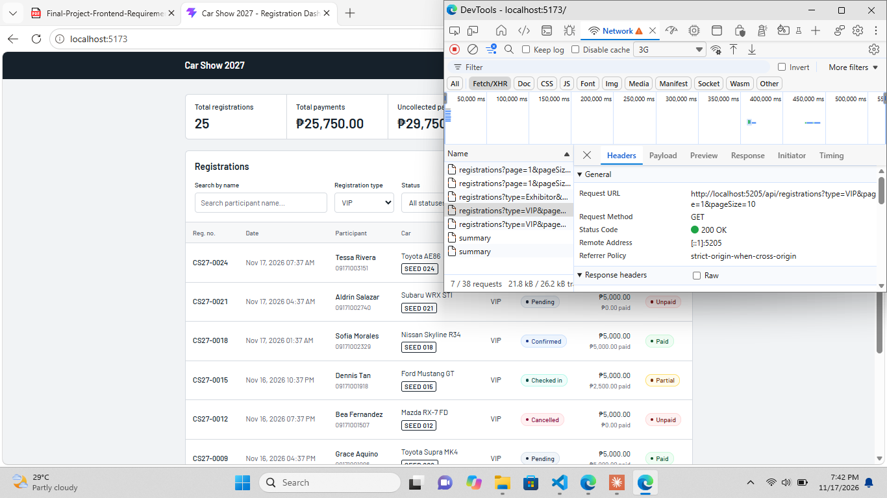

#### 9b. JSON Response Payload
Status: `200 OK` (JSON Array & Pagination Metadata)

Shows the raw JSON payload returned by the C# Minimal API endpoint under the DevTools Response preview. The response object contains the full `items` array along with pagination metadata (`page: 1`, `pageSize: 10`, `totalCount: 25`, `totalPages: 3`). Each participant item includes typed properties such as `registrationNumber`, ISO 8601 UTC `registrationDate`, `carMakeModel`, `plateNumber`, `registrationType`, `status`, `registrationFee`, `amountPaid`, and calculated `paymentStatus`.

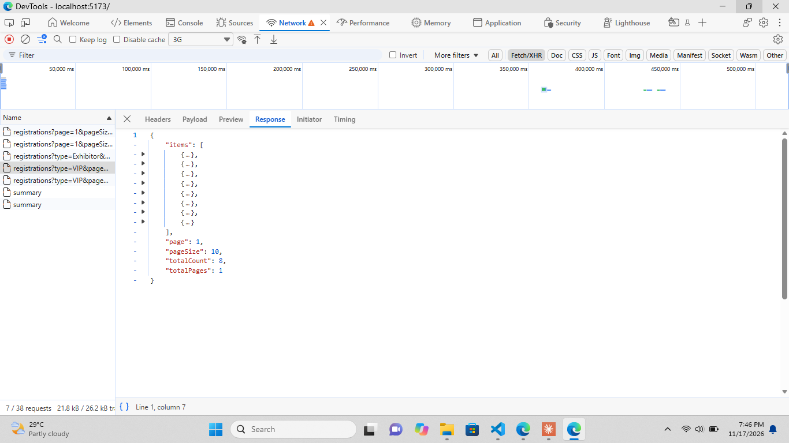

---

### Screenshot 10 — GitHub Commit History

Shows the granular, atomic Git commit history created by the Frontend Developer (Andrew DeVera) throughout development, adhering to the project requirements for clear, meaningful commit messages across all feature implementations.

#### 10a. Commit History (Page 1)
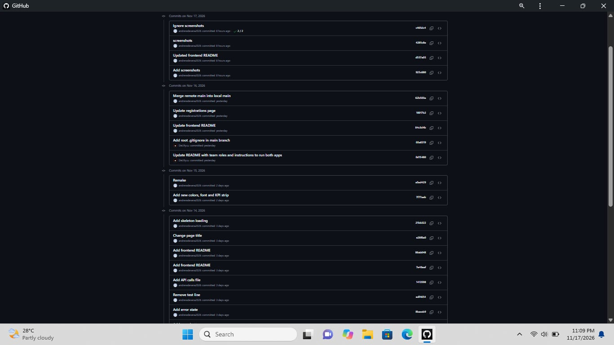

#### 10b. Commit History (Page 2)
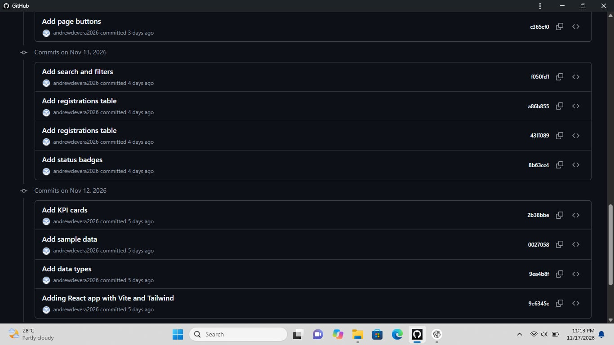

#### 10c. Commit History (Page 3)
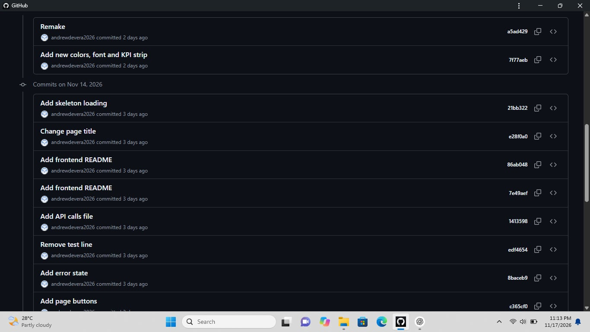

#### 10d. Commit History (Page 4)
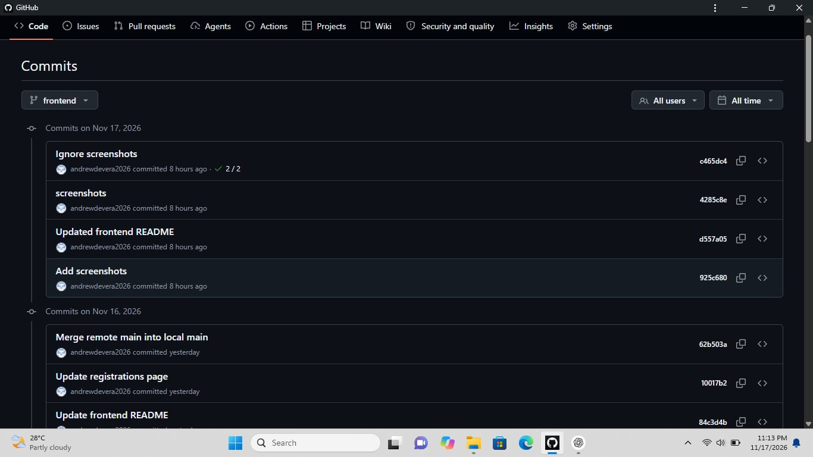

---

### Screenshot 11 — Running Full Application (API & React App Integration)

Shows both sides of the application running together in a local development environment. The .NET 10 Minimal API backend runs in the terminal on port 5205 (`http://localhost:5205`), while the React Vite development server runs on port 5173 (`http://localhost:5173`). In the browser window, the dashboard actively renders live KPI numbers, registration rows, and pagination controls. This confirms complete end-to-end integration, functional CORS headers, and real-time client-server communication.

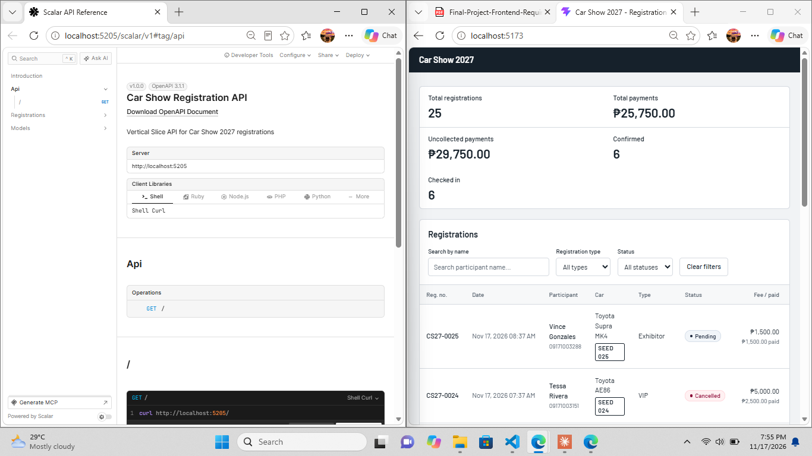
