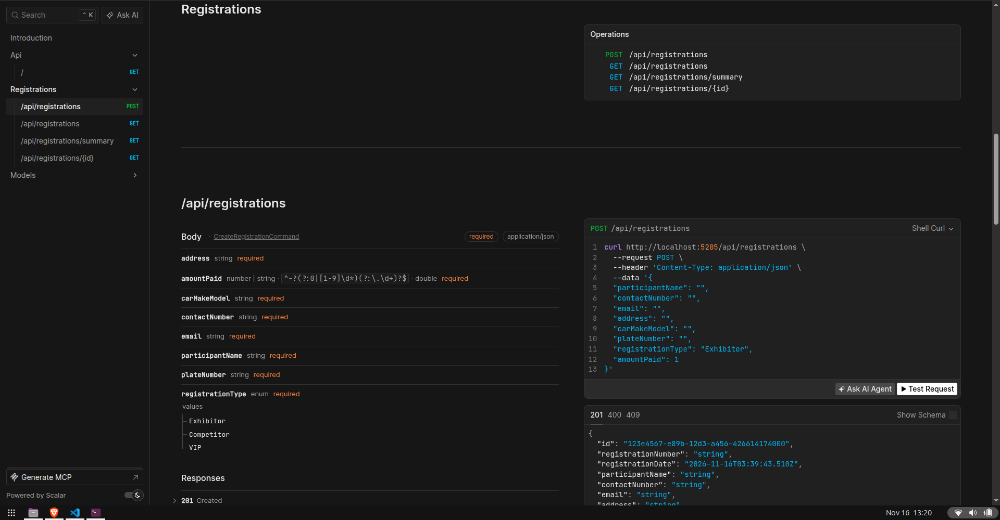
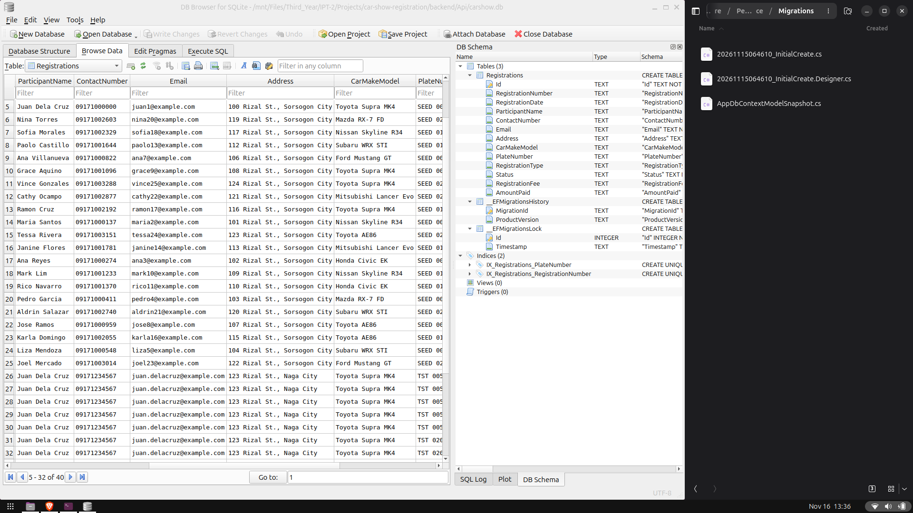
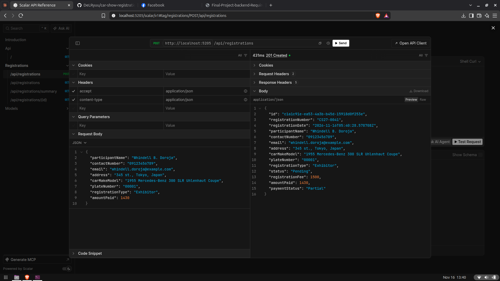
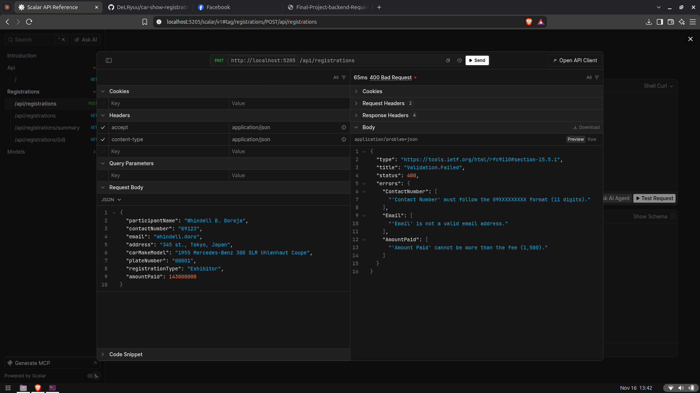
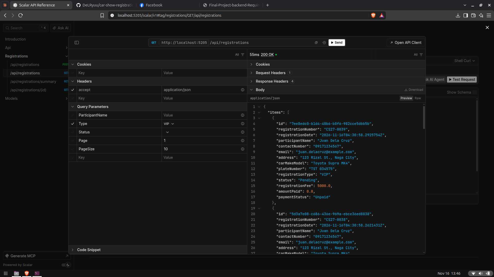
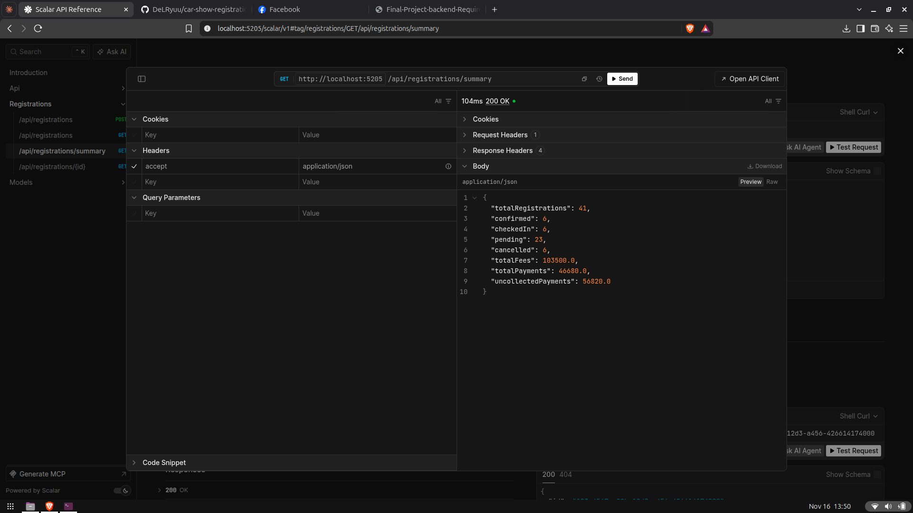
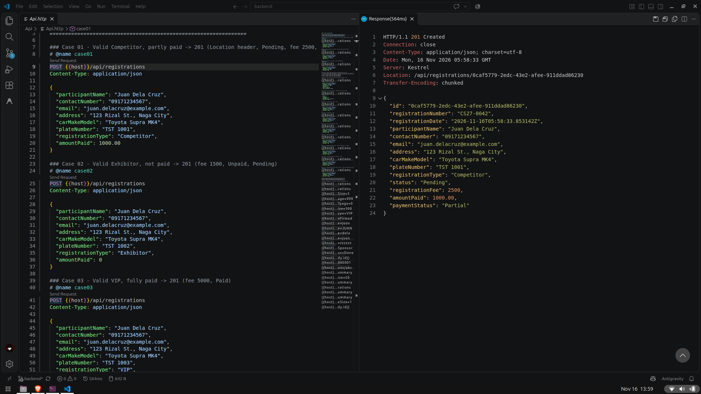
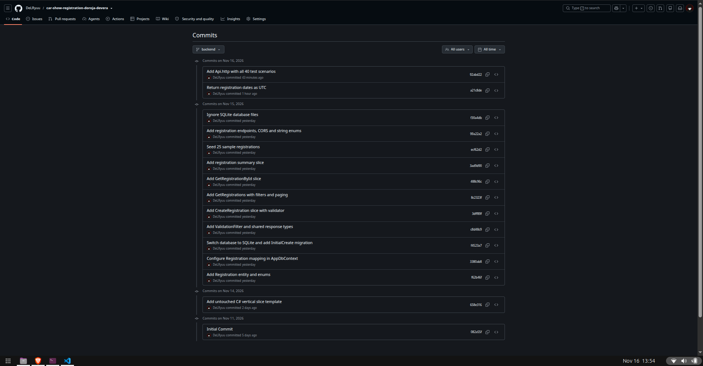

# Car Show Registration System (Car Show 2027) — Verification & Documentation

This directory contains the complete verification evidence, endpoint test results, database schema inspections, and application integration screenshots required for the **Integrative Programming 2** test project.

---

## Team & Roles

| Member | Role | Responsibilities |
| :--- | :--- | :--- |
| **Whindell Doroja** | Backend Developer | .NET 10 Minimal APIs, Vertical Slice Architecture, EF Core SQLite persistence, FluentValidation, Scalar OpenAPI, test scenarios |
| **Andrew DeVera** | Frontend Developer | React 19, Vite, Tailwind CSS, KPI dashboard cards, registration table, filters, pagination |

---

## Table of Contents

- [Part 1: Backend Verification Screenshots (Whindell Doroja)](#part-1-backend-verification-screenshots-whindell-doroja)
  1. [Screenshot 1 — Solution & Folder Structure (Vertical Slices)](#screenshot-1--solution--folder-structure)
  2. [Screenshot 2 — Scalar OpenAPI Interactive Documentation](#screenshot-2--scalar-openapi-interactive-documentation)
  3. [Screenshot 3 — SQLite Database (`carshow.db`) & EF Core Migrations](#screenshot-3--sqlite-database-carshowdb--ef-core-migrations)
  4. [Screenshot 4 — POST: Successful Registration (201 Created)](#screenshot-4--post-successful-registration-201-created)
  5. [Screenshot 5 — POST: Validation Errors (400 Bad Request)](#screenshot-5--post-validation-errors-400-bad-request)
  6. [Screenshot 6 — POST: Duplicate Plate Number (409 Conflict)](#screenshot-6--post-duplicate-plate-number-409-conflict)
  7. [Screenshot 7 — GET All: Paginated Registrations List](#screenshot-7--get-all-paginated-registrations-list)
  8. [Screenshot 8 — GET Filtered Registrations](#screenshot-8--get-filtered-registrations)
     - [8a. Filter by Registration Type (`?type=Competitor` / `?type=VIP`)](#8a-filter-by-registration-type)
     - [8b. Filter by Registration Status (`?status=Pending`)](#8b-filter-by-registration-status)
     - [8c. Filter by Participant Name (`?participantName=juan`)](#8c-filter-by-participant-name)
  9. [Screenshot 9 — GET by ID (Found & Not Found)](#screenshot-9--get-by-id-found--not-found)
     - [9a. GET by ID — Found (200 OK)](#9a-get-by-id--found-200-ok)
     - [9b. GET by ID — Not Found (404 Not Found)](#9b-get-by-id--not-found-404-not-found)
  10. [Screenshot 10 — GET Registration Summary (KPI Totals)](#screenshot-10--get-registration-summary-kpi-totals)
  11. [Screenshot 11 — Test Scenarios & `Api.http` Suite](#screenshot-11--test-scenarios--apihttp-suite)
  12. [Screenshot 12 — GitHub Commit History](#screenshot-12--github-commit-history)
  13. [Screenshot 13 — Running Full Application (React Dashboard Integration)](#screenshot-13--running-full-application-react-dashboard-integration)
- [Part 2: Frontend Verification Screenshots (Andrew DeVera)](#part-2-frontend-verification-screenshots-andrew-devera)
  1. [FE-1: KPI Cards Strip](#fe-1-kpi-cards-strip)
  2. [FE-2: Registrations Table with Status & Payment Badges](#fe-2-registrations-table-with-status--payment-badges)
  3. [FE-3: Debounced Participant Name Search](#fe-3-debounced-participant-name-search)
  4. [FE-4: Filter by Type & Status with Clear Filters Button](#fe-4-filter-by-type--status-with-clear-filters-button)
  5. [FE-5: Pagination Controls & Page Size Selector](#fe-5-pagination-controls--page-size-selector)
  6. [FE-6: Loading Skeleton, Empty State & Error Handling](#fe-6-loading-skeleton-empty-state--error-handling)
  7. [FE-7: Live Backend Integration (Vite + .NET 10 API via CORS)](#fe-7-live-backend-integration-vite--net-10-api-via-cors)
  8. [FE-8: Responsive UI / Full Dashboard Overview](#fe-8-responsive-ui--full-dashboard-overview)

---

# Part 1: Backend Verification Screenshots (Whindell Doroja)

### Screenshot 1 — Solution & Folder Structure

Shows the Clean Architecture + Vertical Slice Architecture layout in .NET 10. Each feature is encapsulated in `Application/Features/Registrations/` containing its command/query, handler, and validator together. Zero cross-slice pollution.

---

### Screenshot 2 — Scalar OpenAPI Interactive Documentation

Shows the Scalar API Reference UI running at `http://localhost:5205/scalar/v1`, listing all registration endpoints under the `/api/registrations` route group.

---

### Screenshot 3 — SQLite Database (`carshow.db`) & EF Core Migrations

Shows the `carshow.db` database opened in DB Browser for SQLite with the 25 seeded records, unique database indexes on `PlateNumber` and `RegistrationNumber`, and the `Infrastructure/Persistence/Migrations/` folder.

---

### Screenshot 4 — POST: Successful Registration (201 Created)

Shows a successful registration creation returning `201 Created`. Demonstrates server-side generation of sequential number (`CS27-xxxx`), UTC `RegistrationDate`, fee determination based on type (Exhibitor: ₱1,500, Competitor: ₱2,500, VIP: ₱5,000), dynamic `PaymentStatus` calculation, and `Location` header pointing to the new resource.

---

### Screenshot 5 — POST: Validation Errors (400 Bad Request)

Shows validation handling through `ValidationFilter<T>` using FluentValidation. When required fields are missing or invalid (e.g. invalid contact number format, invalid email, empty fields), the endpoint short-circuits and returns `400 Bad Request` with structured `ProblemDetails` containing field-level errors.

---

### Screenshot 6 — POST: Duplicate Plate Number (409 Conflict)

Shows duplicate plate number prevention (one car = one registration). Attempting to register an existing vehicle plate returns a `409 Conflict` status code with ProblemDetails specifying `Registration.Conflict`.

---

### Screenshot 7 — GET All: Paginated Registrations List

Shows `GET /api/registrations?page=1&pageSize=10` returning a paginated list of registrations ordered by `RegistrationDate` descending (newest first), with total count, current page, page size, and total pages metadata.

---

### Screenshot 8 — GET Filtered Registrations

Demonstrates server-side query filtering across types, statuses, and participant names.

#### 8a. Filter by Registration Type
Query: `GET /api/registrations?type=Competitor` (or `?type=VIP`)

#### 8b. Filter by Registration Status
Query: `GET /api/registrations?status=Pending`

#### 8c. Filter by Participant Name
Query: `GET /api/registrations?participantName=juan` (case-insensitive substring match)

---

### Screenshot 9 — GET by ID (Found & Not Found)

Demonstrates fetching single registration details by GUID identifier with route constraint (`{id:guid}`).

#### 9a. GET by ID — Found (200 OK)
Returns `200 OK` with full registration record.

#### 9b. GET by ID — Not Found (404 Not Found)
Returns `404 Not Found` with ProblemDetails (`Registration.NotFound`) when a non-existent GUID is queried.

---

### Screenshot 10 — GET Registration Summary (KPI Totals)

Shows `GET /api/registrations/summary` returning aggregated metrics for the frontend KPI dashboard cards: `totalRegistrations`, counts per status (`confirmed`, `checkedIn`, `pending`, `cancelled`), and financial sums (`totalFees`, `totalPayments`, `uncollectedPayments`). Cancelled registrations are strictly excluded from revenue calculations.

---

### Screenshot 11 — Test Scenarios & `Api.http` Suite

Shows execution and verification of the 40 test scenarios defined in `Api.http` matching Section 3G of the project specification (POST creation rules, validation constraints, pagination, filtering, summary accuracy, and error handling).

---

### Screenshot 12 — GitHub Commit History

Shows the granular, atomic Git commit history created by the Backend Developer throughout development, adhering to the project requirements for clear, meaningful commit messages.

---

### Screenshot 13 — Running Full Application (React Dashboard Integration)

Shows the full integrated stack in action: the React 19 + Tailwind CSS frontend dashboard running on `http://localhost:5173` successfully communicating with the C# / .NET 10 API backend on `http://localhost:5205`. Live KPI totals, filtering, and table rendering are fully operational.

---

# Part 2: Frontend Verification Screenshots (Andrew DeVera)

> **Note for Andrew:** Place your screenshot images inside [`docs/screenshots/frontend-screenshots/`](./screenshots/frontend-screenshots/) using the suggested filenames below, or update the image links as needed.

---

### FE-1: KPI Cards Strip

Shows the 5 summary KPI cards rendered at the top of the dashboard:
- **Total Registrations**
- **Total Payments** (formatted as Philippine Peso `₱`)
- **Uncollected Payments**
- **Confirmed Count**
- **Checked In Count**

> *Add image: `docs/screenshots/frontend-screenshots/fe-01-kpi-cards.png`*

---

### FE-2: Registrations Table with Status & Payment Badges

Shows the main registrations table displaying participant name, car make & model, plate number, type, date, registration fee, amount paid, and custom styled badges:
- **Status Badges:** `Pending` (yellow), `Confirmed` (blue), `CheckedIn` (green), `Cancelled` (red)
- **Payment Badges:** `Unpaid` (red), `Partial` (amber), `Paid` (emerald)

> *Add image: `docs/screenshots/frontend-screenshots/fe-02-table-badges.png`*

---

### FE-3: Debounced Participant Name Search

Shows the live participant search input in action, leveraging the `useDebounce` hook (400ms delay) to prevent excessive API requests while typing.

> *Add image: `docs/screenshots/frontend-screenshots/fe-03-search-debounce.png`*

---

### FE-4: Filter by Type & Status with Clear Filters Button

Shows the dropdown filters for **Registration Type** (`Exhibitor`, `Competitor`, `VIP`) and **Status** (`Pending`, `Confirmed`, `CheckedIn`, `Cancelled`), along with the **Clear filters** button resetting the table view.

> *Add image: `docs/screenshots/frontend-screenshots/fe-04-filters.png`*

---

### FE-5: Pagination Controls & Page Size Selector

Shows the bottom pagination bar with page numbers, Previous/Next navigation buttons, "Showing x–y of N registrations" summary, and the page-size selector dropdown (5, 10, 20 items per page).

> *Add image: `docs/screenshots/frontend-screenshots/fe-05-pagination.png`*

---

### FE-6: Loading Skeleton, Empty State & Error Handling

Shows the UI state management:
- **Loading Skeleton (`TableSkeleton.tsx`):** Animated shimmer placeholder rows while data fetches.
- **Empty State:** Friendly fallback when search or filters return zero matches.
- **Error State:** Error banner with a "Try again" retry button if the API is unreachable.

> *Add image: `docs/screenshots/frontend-screenshots/fe-06-states.png`*

---

### FE-7: Live Backend Integration (Vite + .NET 10 API via CORS)

Shows the React frontend configured with `VITE_API_BASE_URL=http://localhost:5205` in `frontend/.env.development` consuming live backend data via `src/api/registrationsApi.ts`, with DevTools Network tab showing successful 200 HTTP calls.

> *Add image: `docs/screenshots/frontend-screenshots/fe-07-live-api.png`*

---

### FE-8: Responsive UI / Full Dashboard Overview

Shows the overall dashboard layout and responsiveness, highlighting Tailwind CSS responsive design, typography, and KPI cards across desktop and compact viewports.

> *Add image: `docs/screenshots/frontend-screenshots/fe-08-full-dashboard.png`*

